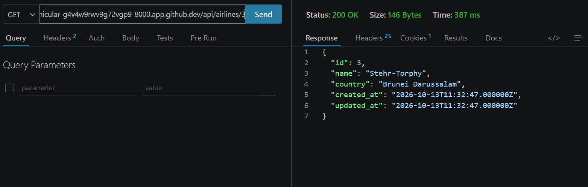

# Repülőjárat-foglaló API (Laravel)

## Futtatás GitHub Codespaces-ben

A project készítése közben az eszközön nem volt php, és jogosultság hiányában a tesztelés githubos Codespace és lokális VS Code segítségével valósult meg.

1. A repóban: **Code** → **Codespaces** → **Create codespace on main**
2. A terminálban:

```
   cp .env.example .env
   composer install
   php artisan key:generate
   touch database/database.sqlite
   php artisan migrate:fresh --seed
   php artisan serve
```

## Tesztelés

A teszteléshez a VS Code **Thunder Client** bővítményét használtam. A Thunder Client ingyenes verziója nem fut Codespace-ben, ezért a helyi VS Code-ból küldtem a kéréseket a Codespace nyilvános címére:

1. Codespace → **Ports** fül → 8000-es port → **Port Visibility: Public**
2. A port címe (`https://...-8000.app.github.dev`) a Thunder Clientben a kérések alap URL-je

### Járatok lekérdezése – `GET /api/flights`


### Egy légitársaság lekérdezése – `GET /api/airlines/3`

